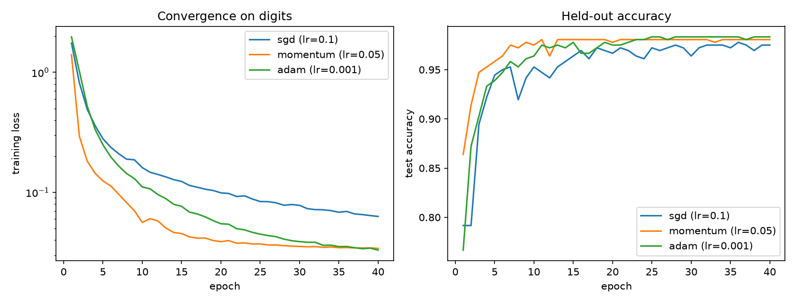

# neural-network-from-scratch

A feedforward neural network implemented from first principles using only NumPy. Everything that a deep learning framework would normally hide is written out explicitly: the forward pass, backpropagation through every layer, the optimizers, the initialization schemes, and the regularizers. A numerical gradient checker verifies the analytic gradients against central-difference estimates.

## What it implements

- Layers: `Dense`, `ReLU`, `Sigmoid`, and inverted `Dropout`
- Loss: softmax fused with cross entropy for a numerically stable gradient
- Optimizers: `SGD`, `Momentum`, and `Adam` with bias correction
- Initialization: He (Kaiming) and Xavier (Glorot) normal schemes
- Regularization: L2 weight decay and inverted dropout
- A `Sequential` container, a minibatch training loop with metric history, and a numerical gradient-check utility

## What it does not do

This is an educational, CPU-only implementation. There are no convolutions, no GPU support, no autograd graph, no batch normalization, and no serialization. For anything beyond small dense networks, use PyTorch or JAX. The point of this repository is to show that I can build and verify the core machinery those frameworks automate.

## Install

Requires Python 3.11 or newer.

```
git clone https://github.com/aamirmalik-dr/neural-network-from-scratch.git
cd neural-network-from-scratch
python -m venv .venv
.venv\Scripts\activate        # on Linux or macOS: source .venv/bin/activate
pip install -e ".[dev]"
```

## Run

Train on the bundled 8x8 digits dataset (no download needed):

```
python scripts/train.py --dataset digits --optimizer adam --epochs 30
```

Compare the three optimizers from identical initial weights and produce a convergence figure:

```
python scripts/benchmark.py --dataset digits --epochs 40
```

Optionally fetch full MNIST (cached locally, falls back to digits if the download fails):

```
python scripts/download_data.py
python scripts/train.py --dataset mnist --optimizer adam --epochs 10 --dropout 0.1
```

Run the test suite and linter:

```
pytest -q
ruff check src tests scripts
```

There is also a short walkthrough notebook with embedded outputs at `notebooks/demo.ipynb`.

## Results

All numbers below were produced by running the commands above on this codebase (seed 0). The digits dataset uses a stratified 80/20 split (1437 train, 360 test).

### Optimizer comparison, digits, 40 epochs, identical initial weights

| Optimizer | Learning rate | Test accuracy |
|-----------|---------------|---------------|
| SGD       | 0.1           | 0.9750        |
| Momentum  | 0.05          | 0.9806        |
| Adam      | 0.001         | 0.9833        |



### Single training runs

| Dataset | Model | Epochs | Test accuracy |
|---------|-------|--------|---------------|
| digits (8x8, 1797 samples) | 64-128-128-10, ReLU, L2 1e-4 | 30 | 0.9833 |
| MNIST (28x28, 70000 samples) | 784-128-128-10, ReLU, L2 1e-4, dropout 0.1 | 10 | 0.9803 |

The MNIST run trains on the full 60000 image training split and evaluates on the
10000 image test split, entirely on CPU. It reaches 0.9803 test accuracy in 10
epochs with Adam.

### Gradient check

The numerical gradient check on a 64-16-10 network with L2 regularization reports a maximum symmetric relative error of about 2e-9 between backpropagation and central differences (the test suite enforces < 1e-5).

## Project layout

```
src/nnscratch/       library: layers, losses, model, optimizers, initializers,
                     training loop, gradient check, data loading
scripts/             train.py, benchmark.py, download_data.py
notebooks/demo.ipynb executed walkthrough with embedded outputs
tests/               pytest suite: gradient checks, shapes, optimizer behavior,
                     end-to-end training accuracy
```

## Design notes

- Softmax and cross entropy are fused into one object so the backward pass is simply `(probs - onehot) / batch`, avoiding an explicit softmax Jacobian.
- L2 decay is applied inside `Dense.backward` and the matching `0.5 * l2 * ||w||^2` penalty is added to the reported loss, so the gradient check covers regularization too.
- Dropout uses the inverted convention: surviving activations are scaled by `1 / keep_prob` during training, so inference is a plain forward pass.
- Optimizers update parameter arrays in place and hold their state (velocity, moment estimates) positionally, keeping the model and optimizer fully decoupled.

## Author

Aamir Malik

- GitHub: https://github.com/aamirmalik-dr
- LinkedIn: https://linkedin.com/in/dr-aamirmalik

## License

MIT, see [LICENSE](LICENSE).
