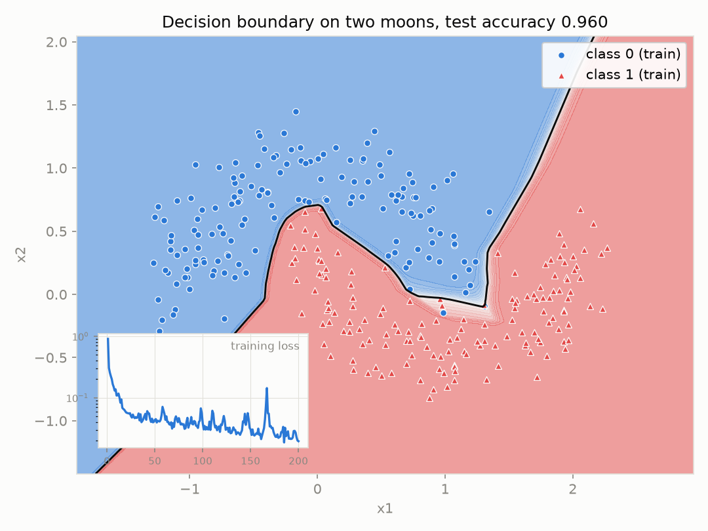
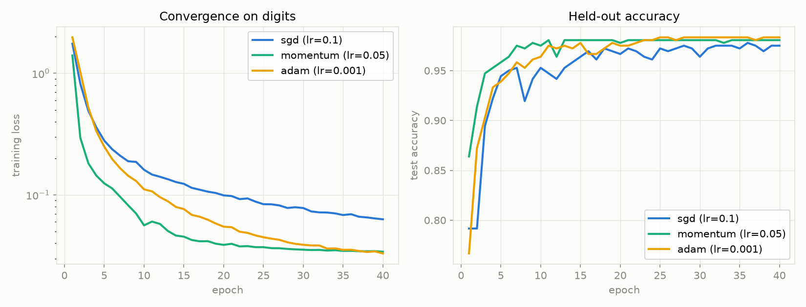

# neural-network-from-scratch

I wanted to know, concretely, everything a deep learning framework does between
`loss.backward()` and the next parameter update. So I built it: a feedforward
network in pure NumPy where every gradient is derived by hand, implemented
explicitly, and then proven correct against numerical differentiation. This
README walks the same path the code does: forward pass, backpropagation,
the correctness proof, and the optimizers. If you want the trained result
first, here it is, produced offline from the committed toy dataset in about
30 seconds:



```
git clone https://github.com/aamirmalik-dr/neural-network-from-scratch.git
cd neural-network-from-scratch
python -m venv .venv && .venv\Scripts\activate   # Linux/macOS: source .venv/bin/activate
pip install -e ".[dev]"
python scripts/plot_decision_boundary.py          # no network access needed
```

That command trains a 2-32-32-2 ReLU network on `data/two_moons.csv` (400
synthetic points, committed, generated by `scripts/make_toy_data.py` with a
fixed seed), runs a gradient check first, and regenerates the figure above
plus `results/metrics.json` and the trained weights
`results/two_moons_model.npz`.

The richest entry point is the narrated notebook,
[`notebooks/demo.ipynb`](notebooks/demo.ipynb), which derives everything below
with executed outputs embedded. The full index-level math lives in
[`docs/math.md`](docs/math.md).

## 1. The forward pass

For a batch `X` with one sample per row, a `Dense` layer computes an affine
map and an activation bends it:

    Z = X W + b,    A = ReLU(Z) = max(0, Z)

Stack a few of these, end with a `Dense` layer producing one logit per class,
and score with softmax cross entropy:

    p_j = exp(z_j) / sum_k exp(z_k),    L = -log(p_y)

Each layer caches exactly what its backward pass will need: `Dense` caches its
input, `ReLU` its sign mask, `Sigmoid` its output, `Dropout` its mask.

## 2. Backpropagation is the chain rule, organized

Every layer implements one contract: given `dZ`, the gradient of the loss with
respect to my output, return `dX` for my input and store my parameter
gradients. The `Sequential` container calls `backward` in reverse order, so no
layer knows its neighbors.

The two derivations that carry the whole library:

**Fused softmax cross entropy.** Writing `L = -z_y + log(sum_k exp(z_k))` and
differentiating gives

    dL/dz_j = p_j - 1[j = y]

which is why the two operations are fused: the gradient is one subtraction
instead of a `C x C` softmax Jacobian per sample.

**The Dense layer.** With `Z = X W + b`, the chain rule yields three
gradients, and the array shapes force each formula:

    dW = X^T dZ        shape (d_in, d_out)
    db = dZ.sum(axis=0)
    dX = dZ W^T        shape (n, d_in)

Elementwise activations have diagonal Jacobians, so their backward pass is a
single elementwise product: `dZ = dA * 1[Z > 0]` for ReLU and
`dZ = dA * s(1 - s)` for sigmoid. L2 decay adds `l2 * W` inside
`Dense.backward` and the matching `0.5 * l2 * ||W||^2` penalty to the reported
loss, so regularization is covered by the gradient check too. Section by
section derivations, including initialization variance arguments, are in
[`docs/math.md`](docs/math.md).

## 3. The correctness proof

A derivation on paper is not evidence the code is right. The proof is
numerical: for every single parameter entry, the central difference

    dL/dp ~ (L(p + eps) - L(p - eps)) / (2 eps)

approximates the gradient with `O(eps^2)` error and knows nothing about my
backward pass. `src/nnscratch/gradient_check.py` compares it against
backpropagation using the symmetric relative error. The outcomes are
unambiguous: a correct implementation lands near 1e-8 in float64, a wrong
gradient lands near 1e-2.

Measured in this repository (committed in `results/metrics.json`): maximum
symmetric relative error **5.1e-9** over all parameter arrays of the two moons
architecture, checked after a short warmup so no ReLU sits exactly on its
kink, where central differences are undefined.

The part of the test suite I trust most is
[`tests/test_gradient_check.py`](tests/test_gradient_check.py). It checks
gradients at two levels: per layer (Dense input, weight, and bias gradients,
ReLU and sigmoid input gradients, the fused loss gradient, the L2 term against
its own penalty function) and whole networks mixing ReLU, sigmoid, depth, and
L2. Any wrong index in any backward pass fails immediately.

## 4. The optimizers

After backward, each parameter `p` holds a gradient `g`. The three optimizers
differ only in the step rule:

    SGD:       p <- p - lr * g
    Momentum:  v <- mu v - lr g;  p <- p + v
    Adam:      m, v track g and g^2;  p <- p - lr m_hat / (sqrt(v_hat) + eps)

Adam's bias correction is why its first step already has magnitude close to
`lr` regardless of gradient scale, a property the tests check directly. Racing
the three from identical initial weights on the digits dataset:



## Measured results

Every number below was produced by running this code, on this machine, with
the commands shown; the toy and digits numbers are also committed in
`results/metrics.json` and `results/optimizer_metrics.json`. The two moons and
digits runs are controlled validation on small datasets, not benchmarks.

| Experiment | Command | Result |
|------------|---------|--------|
| Gradient check, two moons architecture | `python scripts/plot_decision_boundary.py` | max rel. error 5.1e-9 |
| Two moons, 2-32-32-2, Adam, 200 epochs | `python scripts/plot_decision_boundary.py` | test accuracy 0.960 |
| Digits, optimizer race, 40 epochs | `python scripts/benchmark.py --dataset digits --epochs 40` | SGD 0.9750, Momentum 0.9806, Adam 0.9833 |

The same code also trains on full MNIST from the command line
(`python scripts/train.py --dataset mnist`), which first needs
`python scripts/download_data.py` (about 14 MB from OpenML, cached locally,
not committed). That run is left out of the table above because I only quote
numbers regenerated in this repository's committed results, and MNIST is not
part of the offline sample. The two moons and digits results are.

## What is in the library

```
src/nnscratch/
  layers.py          Dense, ReLU, Sigmoid, inverted Dropout
  losses.py          softmax fused with cross entropy
  model.py           Sequential container, weight save/load (.npz)
  optimizers.py      SGD, Momentum, Adam
  initializers.py    He and Xavier normal schemes
  training.py        minibatch loop with metric history
  gradient_check.py  central-difference verification
  data.py            two moons generator, digits, MNIST loading
docs/math.md         the full backpropagation derivation
notebooks/demo.ipynb narrated tutorial with executed outputs
scripts/             quickstart, training CLI, benchmark, data tools
results/             committed figures, metrics, trained toy weights
tests/               pytest suite, gradient checks front and center
```

To load the committed trained toy model without training:

```python
import numpy as np
from nnscratch import Dense, ReLU, Sequential

rng = np.random.default_rng(0)
model = Sequential([
    Dense(2, 32, init="he", rng=rng), ReLU(),
    Dense(32, 32, init="he", rng=rng), ReLU(),
    Dense(32, 2, init="xavier", rng=rng),
])
model.load_weights("results/two_moons_model.npz")
print(model.predict(np.array([[0.0, 1.0], [1.0, -0.5]])))  # [0 1]
```

## Scope, honestly

This is an educational, CPU-only implementation. There are no convolutions, no
autograd graph, no batch normalization, no GPU support. For anything beyond
small dense networks, use PyTorch or JAX. The point of this repository is to
show the machinery those frameworks automate, derived, implemented, and
verified.

Checks:

```
pytest -q                        # 33 tests, gradient checks included
ruff check src tests scripts
```

## Author

Aamir Malik

- GitHub: https://github.com/aamirmalik-dr
- LinkedIn: https://linkedin.com/in/aamirmalik-dr

## License

MIT, see [LICENSE](LICENSE).

---

*Refactored and engineered into this tested, reproducible project in July 2026, from work originally done for the Programming for AI course at KAIST (Fall 2020).*
